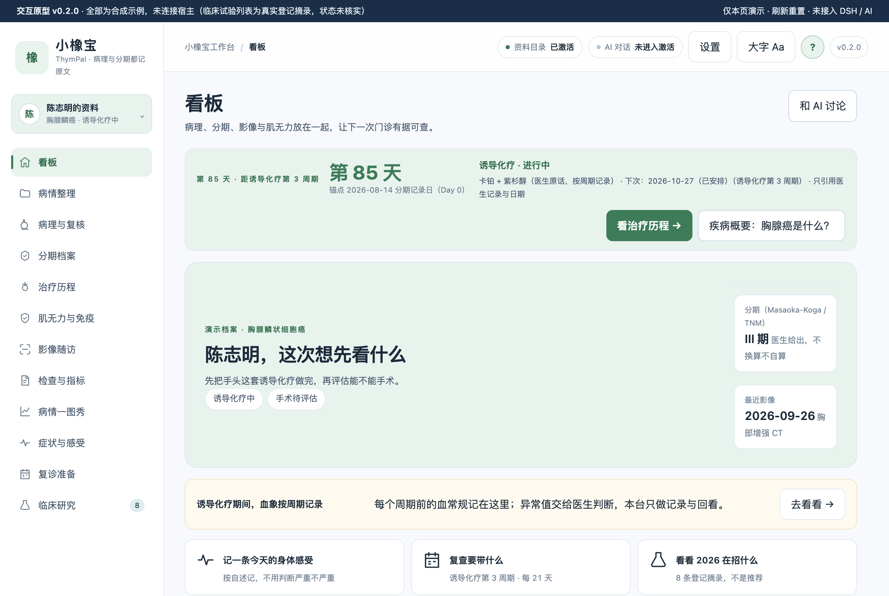
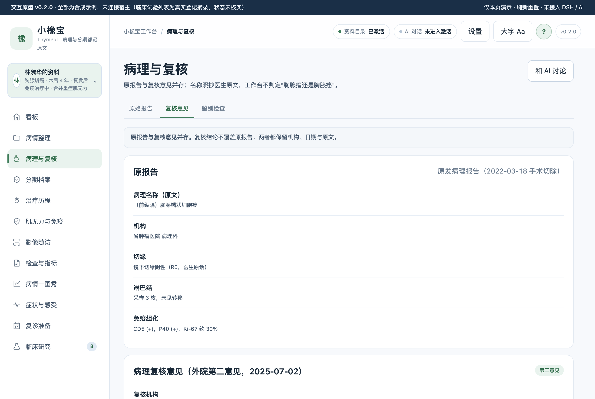
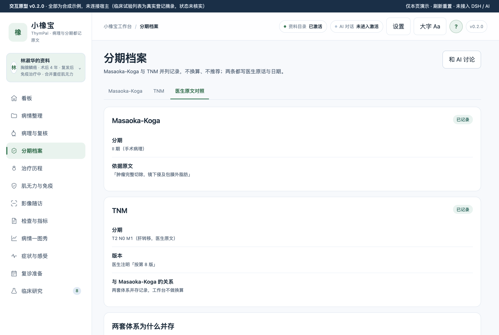
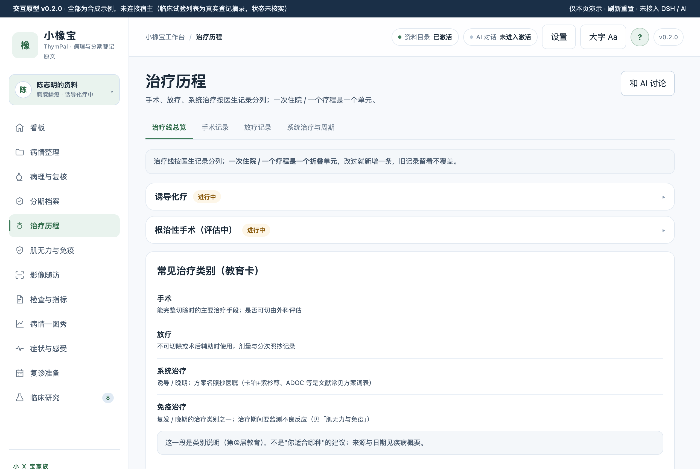
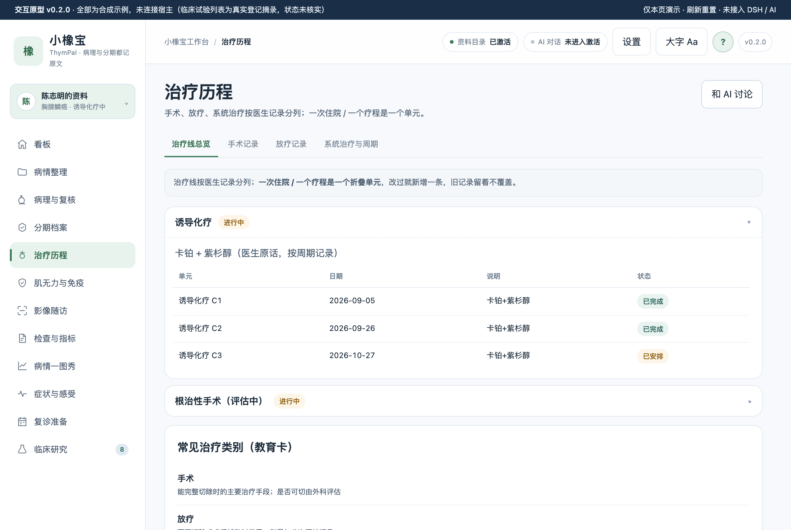
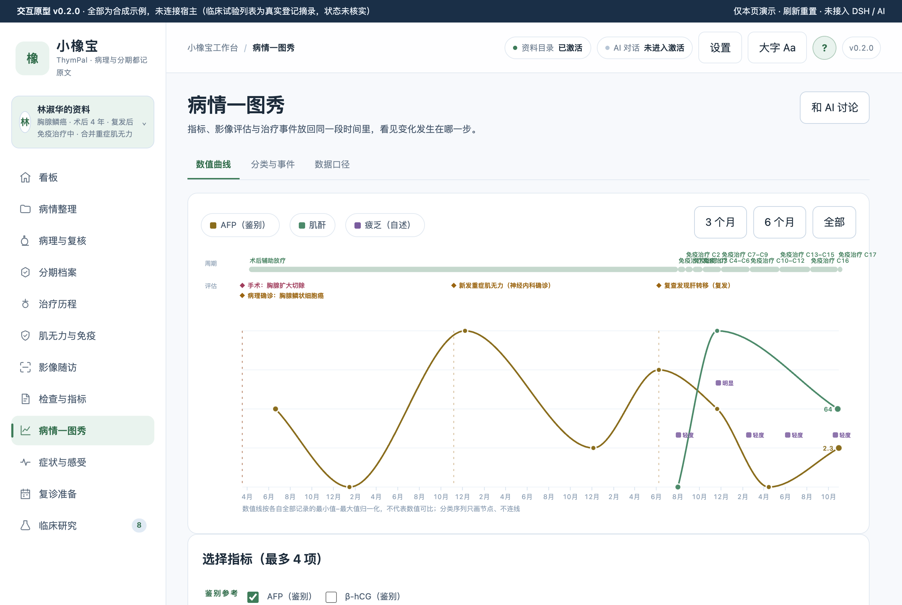
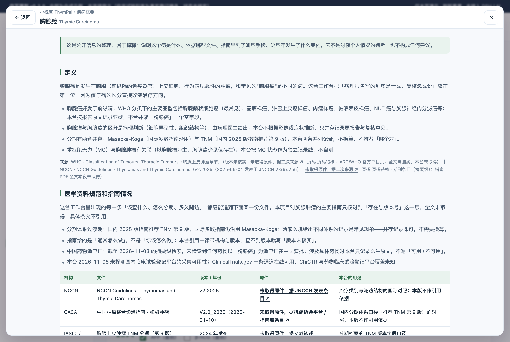

# 小橡宝 · 胸腺癌工作台

本机优先的胸腺癌（前纵隔胸腺上皮肿瘤）病理与复核档案、分期记录（Masaoka-Koga 与 TNM 并列不换算）、手术与后续治疗线、重症肌无力与免疫相关不良反应关联、复查随访工作台

## 疾病概要

胸腺癌是前纵隔胸腺上皮的恶性肿瘤，与"胸腺瘤"是不同的病——一词之差直接改变治疗方向，所以本台把**病理原报告与复核意见并存、逐字保留医生原文**放在第一位。分期有 Masaoka-Koga 与 TNM 两套体系并存（国内 2025 版指南推荐 TNM 第 9 版，国际主流指南仍多用 Masaoka-Koga），本台两条并列记录、不换算、不推荐。胸腺癌没有可靠血清标志物，随访主要靠影像；合并重症肌无力（MG）时治疗期观察是独立一条线。以上是解释层，不构成对个人情况的判断——需要问你的医生。完整四段见工作台顶栏「?」。

## 关键功能（v0.2.0 原型实渲）

**看板：状态卡 + 分期双体系 + 最近影像一屏看清**


**病理与复核：原报告与第二意见并存，不覆盖**


**分期档案：Masaoka-Koga 与 TNM 并列原文对照**


**治疗线折叠卡：一个疗程一个单元，收展自如**



**病情一图秀：指标、治疗带与事件同一段时间轴**


**疾病概要「?」：整页四段（定义 · 指南 · 治疗全景 · 趋势），每段带来源**


## 怎么用

- 原型直接双击打开 `prototypes/v0.2/index.html`（file:// 可用，无需构建）。
- 左上角头像切换两套合成演示档案：陈志明（刚确诊、诱导化疗中、记录少）、林淑华（术后 4 年、复发后免疫治疗、合并 MG、记录多）。
- 顶栏「?」打开疾病概要整页面板；每页标题行「和 AI 讨论」把本页事实填成提示词草稿，不自动发送。
- 数值卡轻点翻面看趋势；分类记录（疲乏、MG 状态）只画节点不连线。

## 数据与口径

- 全部患者数据为**合成示例**，未连接宿主；临床试验列表为真实登记摘录（ClinicalTrials.gov 2026-11-08 采集，8 条，状态未核实；ChiCTR 未采集，覆盖未知）。
- 指南引用只到「存在与版本号」层：NCCN v2.2025、CACA V2.0_2025 全文未取得，二次来源见疾病概要；未取得原件的行都写明。
- 私密记录（情绪类感受）不进导出、不进 AI 草稿、不进看板摘要。
- 本仓为夜班自动开发版本：0 访谈、0 临床审核，全部场景待用户与医学核对者追认（docs/USER-RESEARCH.md）。

## 开发

这是接入骨架 + 已交付 v0.2.0 交互原型。设计提示词 [docs/DESIGN-PROMPT.md](docs/DESIGN-PROMPT.md)；需求 [BRIEF](docs/BRIEF.md)，规格 [SPEC](docs/SPEC.md)，任务 [TASKS](docs/TASKS.md)；先读 [AGENTS](AGENTS.md)。

## 开发顺序

先共创SPEC和候选数据关系，再交付HTML交互工作台；由用户确认对应版本/模块后，复核SCHEMA/API并实现生产功能。确认记录见docs/PROTOTYPE-REVIEW.md；模型不依赖前端Tab/流程。模板骨架不是业务已确认。

## 当前能力

- 一个 DSH 工作台注册、认证的健康接口、版本展示与标准/大字切换。
- 已明确选择布局：business-first。business-first 使用 customFrame；模板不创建会话或复制聊天。需要 AI 协助时按官方合同接入原生 conversation 和会话管理。
- 无业务数据库、无演示患者、无真实密钥；所有业务页按确认 spec 逐项实现。

## 开发与本地验收

需要 Node.js 22+、Git、包管理器和可用 DSH Desktop；采用 SQLite 时另核验 node:sqlite 版本条件。宿主 peers 的范围仅是模板基线，请与目标 Desktop 实际依赖核对。

```bash
npm install
npm run check
npm run pack:check
npm pack
```

`npm run check` 只保证"能装"（语法 + 装包合同），第一天就该是绿的。`npm run audit` 管"还是不是家族里的一员"：版本三处一致、`lib/layout.js` 面板参数单一来源、检查链完整、文档与密钥卫生，**只看代码与文件，不看文档自述**。新项目刚生成时 audit 必然有 fail，那是待办清单；交付/发布前必须清零，存在 fail 不得发布（`npm run release:check` 一次跑完两者）。

跑的时间点：**每次改完**跑 `check`；**G2 原型确认后、写业务代码前**先跑一次 `audit`（这时缺的多是 `lib/layout.js`、`VERSION` 这类结构，越早补越便宜）；**交付/装机前**必须跑 `release:check`；**发布或投稿前**把 `npm run audit --json` 的 `xx/xx 通过 · N 失败 · M 待人工` 抄进 `docs/RELEASE.md` 的「家族一致性」一行。`✗` 是结构缺口（补齐，或在 `docs/DEV-REQUIREMENTS-<日期>.md` 写明偏离理由并由用户确认），`!` 是需人工判断的项（逐条给「已人工确认 / 确实没有」）。

`npm install` 可能按 npm 策略解析 peer；勿为消警告重复打包宿主 runtime。客户端本身是单文件；引入 TS/组件库后需添加构建步骤并保留单文件导出。

本地安装入口以当前 Desktop/CLI 帮助为准。安装后按 [docs/06-VALIDATION-AND-RELEASE.md](docs/06-VALIDATION-AND-RELEASE.md) 与官方自测完成真实 UI 验收，并填写 [docs/ACCEPTANCE.md](docs/ACCEPTANCE.md)。静态检查不代表已加载。

Logo 来源与使用限制见 assets/README.md。许可证、作者、仓库/发布策略由本项目维护者确认后填写；模板默认为 private/UNLICENSED。

感谢小x宝社区、DataElement 社区，以及 sam / hhx / 繁华的 ❤️ 贡献。

初始化来源记录见 `.dsh-wb-starter.json`。更新社区脚手架不会覆盖本项目；需要升级时先用相同确认配置在临时目录生成，再审阅差异。CLI 用法见 [docs/CLI-GIT.md](docs/CLI-GIT.md)。

## HTML先行与数据演进

业务开发前先交付HTML交互工作台原型、实际预览并由用户确认版本/hash和范围。数据设计先区分领域事实、流程状态和页面读模型，走查前端/流程变化、兼容与迁移；原型对象不直接作为表。见[规范](docs/14-HTML-AND-DATA-CONTRACT.md)。
